# SceneShifter: Training-free Multi-Scene Temporal Control for Audio-driven Human Animation

**Jianzhi Long<sup>1</sup>, Rong-Cheng Tu<sup>2✉</sup>, Hao Guan<sup>2</sup>, Siyuan Liang<sup>2</sup>, Shunyu Liu<sup>2</sup>, Xiao Luo<sup>3</sup>, Dacheng Tao<sup>2✉</sup>**

<sup>1</sup> The University of Sydney, New South Wales, Australia  
<sup>2</sup> Generative AI Lab, College of Computing and Data Science, Nanyang Technological University, Singapore, Singapore  
<sup>3</sup> University of Wisconsin–Madison, Wisconsin, USA

✉ Corresponding authors

[Paper](PAPER_LINK) | [Project Page](PROJECT_PAGE_LINK)

## Demo

<details>
<summary style="cursor: pointer; user-select: none;"><b>Audio-driven Human Animation (MultiTalk)</b> — click to show / hide demos</summary>

<div style="overflow-x: auto; overflow-y: hidden; -webkit-overflow-scrolling: touch; max-width: 100%; border: 1px solid #e5e5e5; border-radius: 8px; padding: 8px; margin-top: 8px;">

<table border="0" style="width: max-content; min-width: 100%; border-collapse: separate; border-spacing: 14px 8px;">
<tr>
<td style="vertical-align: top;">
<details>
<summary style="cursor: pointer; user-select: none; padding: 6px 12px; border: 1px solid #bbb; border-radius: 6px; background: #f6f8fa; white-space: nowrap; display: inline-block;"><b>Demo 1</b></summary>
<div style="margin-top: 10px;">

<div style="margin-top: 6px;">urban street → library</div>
</div>
</details>
</td>
<td style="vertical-align: top;">
<details>
<summary style="cursor: pointer; user-select: none; padding: 6px 12px; border: 1px solid #bbb; border-radius: 6px; background: #f6f8fa; white-space: nowrap; display: inline-block;"><b>Demo 2</b></summary>
<div style="margin-top: 10px;">
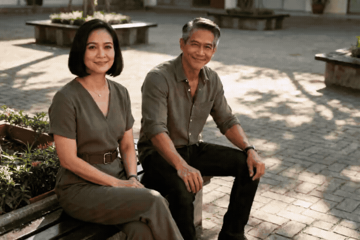
<div style="margin-top: 6px;">courtyard → rooftop terrace → parking garage</div>
</div>
</details>
</td>
<td style="vertical-align: top;">
<details>
<summary style="cursor: pointer; user-select: none; padding: 6px 12px; border: 1px solid #bbb; border-radius: 6px; background: #f6f8fa; white-space: nowrap; display: inline-block;"><b>Demo 3</b></summary>
<div style="margin-top: 10px;">

<div style="margin-top: 6px;">urban street → bus stop → hotel lobby → park → café</div>
</div>
</details>
</td>
<td style="vertical-align: top;">
<details>
<summary style="cursor: pointer; user-select: none; padding: 6px 12px; border: 1px solid #bbb; border-radius: 6px; background: #f6f8fa; white-space: nowrap; display: inline-block;"><b>Demo 4</b></summary>
<div style="margin-top: 10px;">
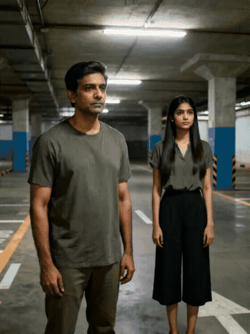
<div style="margin-top: 6px;">parking garage → library → bus stop → conference hall</div>
</div>
</details>
</td>
<td style="vertical-align: top;">
<details>
<summary style="cursor: pointer; user-select: none; padding: 6px 12px; border: 1px solid #bbb; border-radius: 6px; background: #f6f8fa; white-space: nowrap; display: inline-block;"><b>Demo 5</b></summary>
<div style="margin-top: 10px;">
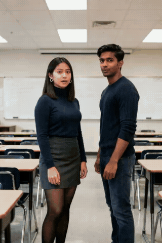
<div style="margin-top: 6px;">classroom → elevator lobby → park → parking garage</div>
</div>
</details>
</td>
<td style="vertical-align: top;">
<details>
<summary style="cursor: pointer; user-select: none; padding: 6px 12px; border: 1px solid #bbb; border-radius: 6px; background: #f6f8fa; white-space: nowrap; display: inline-block;"><b>Demo 6</b></summary>
<div style="margin-top: 10px;">
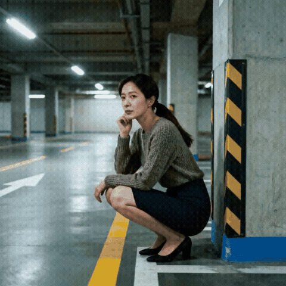
<div style="margin-top: 6px;">parking garage → office</div>
</div>
</details>
</td>
</tr>
<tr>
<td style="vertical-align: top;">
<details>
<summary style="cursor: pointer; user-select: none; padding: 6px 12px; border: 1px solid #bbb; border-radius: 6px; background: #f6f8fa; white-space: nowrap; display: inline-block;"><b>Demo 7</b></summary>
<div style="margin-top: 10px;">

<div style="margin-top: 6px;">urban street → airport</div>
</div>
</details>
</td>
<td style="vertical-align: top;">
<details>
<summary style="cursor: pointer; user-select: none; padding: 6px 12px; border: 1px solid #bbb; border-radius: 6px; background: #f6f8fa; white-space: nowrap; display: inline-block;"><b>Demo 8</b></summary>
<div style="margin-top: 10px;">
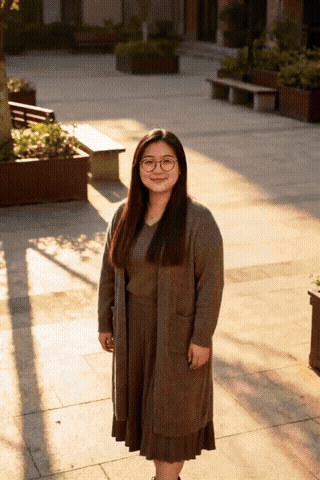
<div style="margin-top: 6px;">courtyard → airport</div>
</div>
</details>
</td>
<td style="vertical-align: top;">
<details>
<summary style="cursor: pointer; user-select: none; padding: 6px 12px; border: 1px solid #bbb; border-radius: 6px; background: #f6f8fa; white-space: nowrap; display: inline-block;"><b>Demo 9</b></summary>
<div style="margin-top: 10px;">

<div style="margin-top: 6px;">airport → supermarket → elevator lobby → parking garage → urban street</div>
</div>
</details>
</td>
<td style="vertical-align: top;">
<details>
<summary style="cursor: pointer; user-select: none; padding: 6px 12px; border: 1px solid #bbb; border-radius: 6px; background: #f6f8fa; white-space: nowrap; display: inline-block;"><b>Demo 10</b></summary>
<div style="margin-top: 10px;">
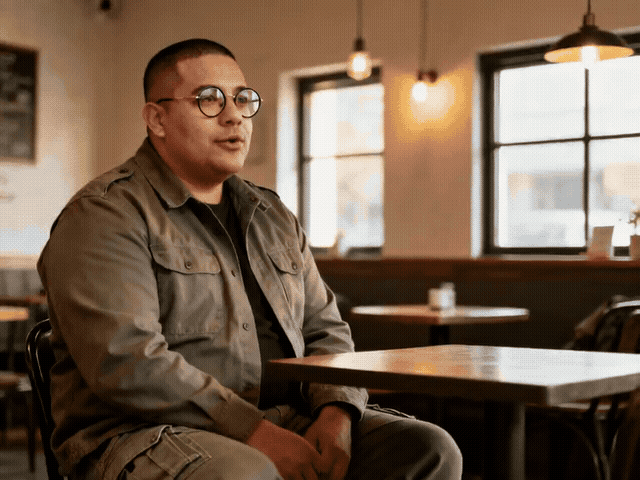
<div style="margin-top: 6px;">café → parking garage</div>
</div>
</details>
</td>
<td style="vertical-align: top;">
<details>
<summary style="cursor: pointer; user-select: none; padding: 6px 12px; border: 1px solid #bbb; border-radius: 6px; background: #f6f8fa; white-space: nowrap; display: inline-block;"><b>Demo 11</b></summary>
<div style="margin-top: 10px;">
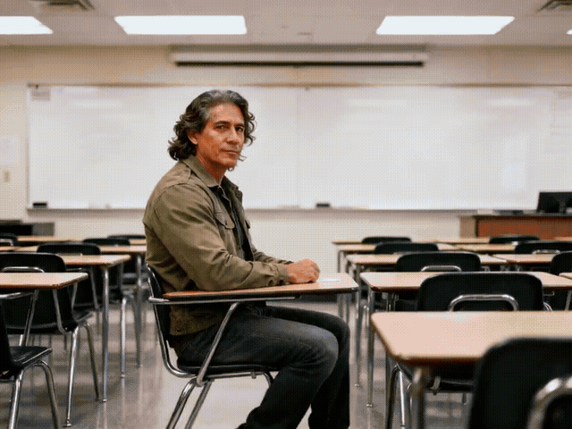
<div style="margin-top: 6px;">classroom → conference hall</div>
</div>
</details>
</td>
</tr>
</table>

</div>
</details>

<details>
<summary style="cursor: pointer; user-select: none;"><b>Video-driven Human Animation (Wan-Animate)</b> — click to show / hide demos</summary>

<div style="overflow-x: auto; overflow-y: hidden; -webkit-overflow-scrolling: touch; max-width: 100%; border: 1px solid #e5e5e5; border-radius: 8px; padding: 8px; margin-top: 8px;">

<table border="0" style="width: max-content; min-width: 100%; border-collapse: separate; border-spacing: 14px 8px;">
<tr>
<td style="vertical-align: top;">
<details>
<summary style="cursor: pointer; user-select: none; padding: 6px 12px; border: 1px solid #bbb; border-radius: 6px; background: #f6f8fa; white-space: nowrap; display: inline-block;"><b>Demo 1</b></summary>
<div style="margin-top: 10px;">
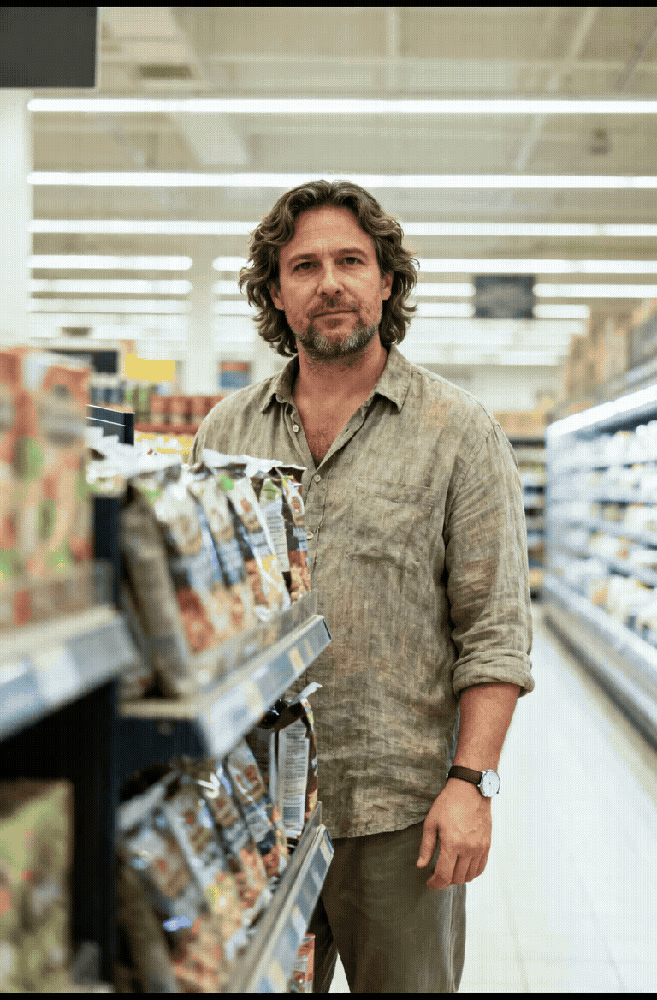
<div style="margin-top: 6px;">supermarket → conference hall → parking garage</div>
</div>
</details>
</td>
<td style="vertical-align: top;">
<details>
<summary style="cursor: pointer; user-select: none; padding: 6px 12px; border: 1px solid #bbb; border-radius: 6px; background: #f6f8fa; white-space: nowrap; display: inline-block;"><b>Demo 2</b></summary>
<div style="margin-top: 10px;">
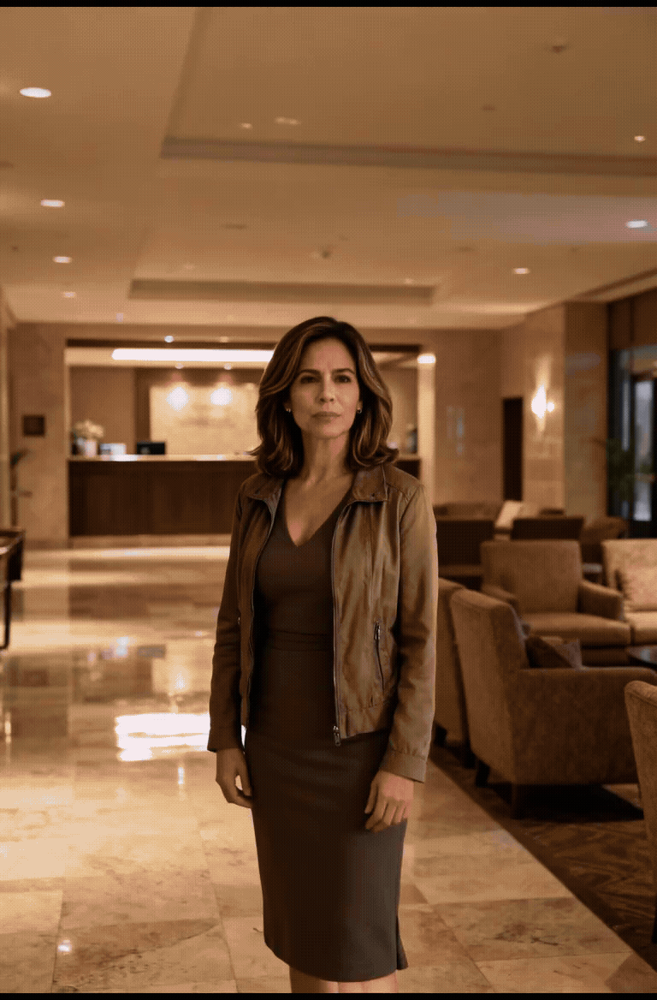
<div style="margin-top: 6px;">hotel lobby → urban street</div>
</div>
</details>
</td>
<td style="vertical-align: top;">
<details>
<summary style="cursor: pointer; user-select: none; padding: 6px 12px; border: 1px solid #bbb; border-radius: 6px; background: #f6f8fa; white-space: nowrap; display: inline-block;"><b>Demo 3</b></summary>
<div style="margin-top: 10px;">
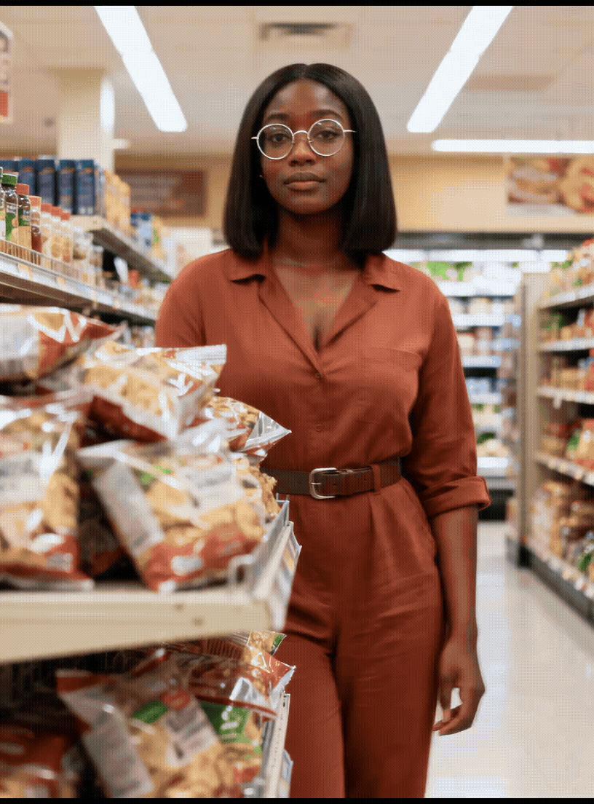
<div style="margin-top: 6px;">supermarket → podcast room → subway → courtyard</div>
</div>
</details>
</td>
<td style="vertical-align: top;">
<details>
<summary style="cursor: pointer; user-select: none; padding: 6px 12px; border: 1px solid #bbb; border-radius: 6px; background: #f6f8fa; white-space: nowrap; display: inline-block;"><b>Demo 4</b></summary>
<div style="margin-top: 10px;">

<div style="margin-top: 6px;">airport → courtyard → office</div>
</div>
</details>
</td>
<td style="vertical-align: top;">
<details>
<summary style="cursor: pointer; user-select: none; padding: 6px 12px; border: 1px solid #bbb; border-radius: 6px; background: #f6f8fa; white-space: nowrap; display: inline-block;"><b>Demo 5</b></summary>
<div style="margin-top: 10px;">
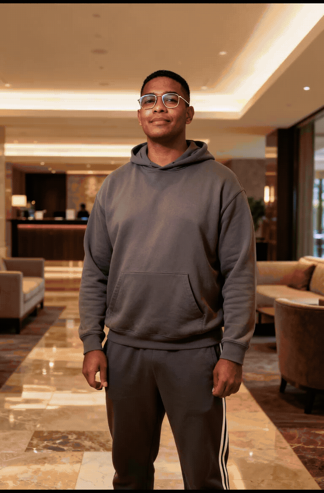
<div style="margin-top: 6px;">hotel lobby → rooftop terrace → covered walkway → supermarket</div>
</div>
</details>
</td>
</tr>
</table>

</div>
</details>

<details>
<summary style="cursor: pointer; user-select: none;"><b>Camera Control (Wan Fun Camera)</b> — click to show / hide demos</summary>

<div style="overflow-x: auto; overflow-y: hidden; -webkit-overflow-scrolling: touch; max-width: 100%; border: 1px solid #e5e5e5; border-radius: 8px; padding: 8px; margin-top: 8px;">

<table border="0" style="width: max-content; min-width: 100%; border-collapse: separate; border-spacing: 14px 8px;">
<tr>
<td style="vertical-align: top;">
<details>
<summary style="cursor: pointer; user-select: none; padding: 6px 12px; border: 1px solid #bbb; border-radius: 6px; background: #f6f8fa; white-space: nowrap; display: inline-block;"><b>Pan left</b></summary>
<div style="margin-top: 10px;">

<div style="margin-top: 6px;">park → hospital</div>
</div>
</details>
</td>
<td style="vertical-align: top;">
<details>
<summary style="cursor: pointer; user-select: none; padding: 6px 12px; border: 1px solid #bbb; border-radius: 6px; background: #f6f8fa; white-space: nowrap; display: inline-block;"><b>Pan right</b></summary>
<div style="margin-top: 10px;">

<div style="margin-top: 6px;">courtyard → elevator lobby → workshop</div>
</div>
</details>
</td>
<td style="vertical-align: top;">
<details>
<summary style="cursor: pointer; user-select: none; padding: 6px 12px; border: 1px solid #bbb; border-radius: 6px; background: #f6f8fa; white-space: nowrap; display: inline-block;"><b>Zoom out</b></summary>
<div style="margin-top: 10px;">

<div style="margin-top: 6px;">museum → parking garage</div>
</div>
</details>
</td>
<td style="vertical-align: top;">
<details>
<summary style="cursor: pointer; user-select: none; padding: 6px 12px; border: 1px solid #bbb; border-radius: 6px; background: #f6f8fa; white-space: nowrap; display: inline-block;"><b>Clockwise</b></summary>
<div style="margin-top: 10px;">

<div style="margin-top: 6px;">supermarket → conference hall → urban street → museum</div>
</div>
</details>
</td>
<td style="vertical-align: top;">
<details>
<summary style="cursor: pointer; user-select: none; padding: 6px 12px; border: 1px solid #bbb; border-radius: 6px; background: #f6f8fa; white-space: nowrap; display: inline-block;"><b>Anti-clockwise</b></summary>
<div style="margin-top: 10px;">
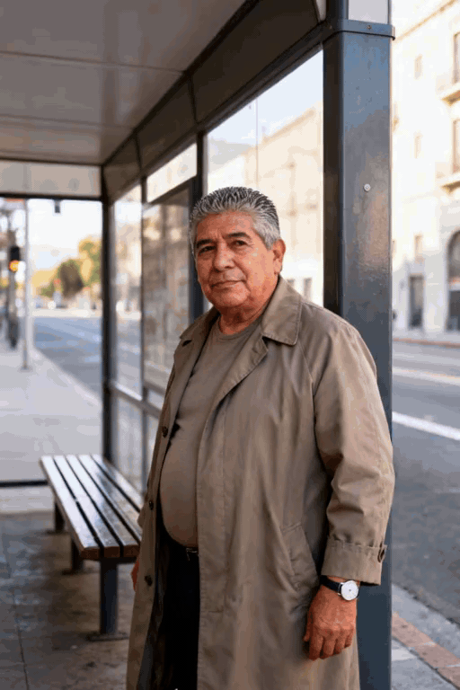
<div style="margin-top: 6px;">bus stop → train station → supermarket → beach</div>
</div>
</details>
</td>
</tr>
</table>

</div>
</details>

## Installation

```bash
# Clone the repository
git clone git@github.com:JamesLong199/SceneShifter.git
cd SceneShifter

# Clone the official backbone code
bash scripts/setup_backbones.sh --backbone [BACKBONE] # e.g. multitalk

# Create environment
bash scripts/setup_envs.sh --family [BACKBONE] # e.g. multitalk
conda activate [ENV] # e.g. sceneshifter_multitalk

# Install dependencies
python -m pip install -e .
```

`--backbone` selects which official repository to clone. It uses the same names as the demo. `wan_s2v` and `wan_animate` both clone Wan2.2. `all` clones every backbone.

`--family` creates the conda environment in that row. The environment runs the backbones in the last column.

| `--family` | Environment | `--backbone` |
|---|---|---|
| `multitalk` | `sceneshifter_multitalk` | `multitalk`, `infinitetalk` |
| `fantasy` | `sceneshifter_fantasy` | `fantasytalking` |
| `wans2v` | `sceneshifter_wans2v` | `wan_s2v`, `wan_animate` |
| `videoxfun` | `sceneshifter_videoxfun` | `wan_fun_camera` |
| `hunyuan` | `sceneshifter_hunyuan` | `hunyuan_avatar` |
| `all` | every environment above | every backbone |

Activate the environment from the row you created, then install this package into it with `python -m pip install -e .`.

## Download checkpoints

Each backbone has its own directory under `weights/`. The download includes the base model and auxiliary models such as audio and text encoders.

```bash
python scripts/download_checkpoints.py --backbone [BACKBONE] # e.g. multitalk
```

`--backbone` accepts `multitalk`, `infinitetalk`, `fantasytalking`, `wan_s2v`, `wan_animate`, `wan_fun_camera`, `hunyuan_avatar`, or `all`.

| `--backbone` | Directory |
|---|---|
| `multitalk` | `weights/multitalk` |
| `infinitetalk` | `weights/infinitetalk` |
| `fantasytalking` | `weights/fantasytalking` |
| `wan_s2v` | `weights/wan_s2v` |
| `wan_animate` | `weights/wan_animate` |
| `wan_fun_camera` | `weights/wan_fun_camera` |
| `hunyuan_avatar` | `weights/hunyuan_avatar` |

## Run a demo

Demo images, audio, and masks are in `examples/demos/`. Each backbone reads its own config in `examples/demos/configs/`.

| Backbone | Command |
|---|---|
| MultiTalk | `conda activate sceneshifter_multitalk && python scripts/generate.py --backbone multitalk --demo examples/demos --output_root outputs/demos` |
| InfiniteTalk | `conda activate sceneshifter_multitalk && python scripts/generate.py --backbone infinitetalk --demo examples/demos --output_root outputs/demos` |
| FantasyTalking | `conda activate sceneshifter_fantasy && python scripts/generate.py --backbone fantasytalking --demo examples/demos --output_root outputs/demos` |
| Wan2.2 S2V | `conda activate sceneshifter_wans2v && python scripts/generate.py --backbone wan_s2v --demo examples/demos --output_root outputs/demos` |
| Wan2.2 Animate | `conda activate sceneshifter_wans2v && python scripts/generate.py --backbone wan_animate --demo examples/demos --output_root outputs/demos` |
| Wan Fun camera | `conda activate sceneshifter_videoxfun && python scripts/generate.py --backbone wan_fun_camera --demo examples/demos --output_root outputs/demos` |
| HunyuanVideo-Avatar | `conda activate sceneshifter_hunyuan && python scripts/generate.py --backbone hunyuan_avatar --demo examples/demos --output_root outputs/demos` |

The video is written to `outputs/demos/<backbone>/videos/`.
